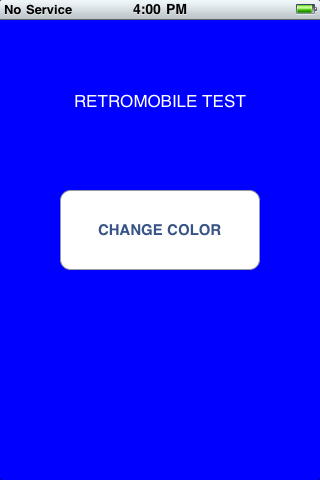
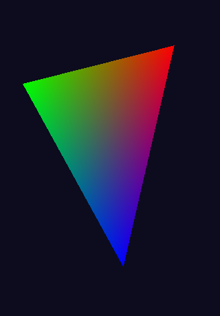
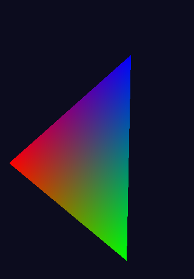
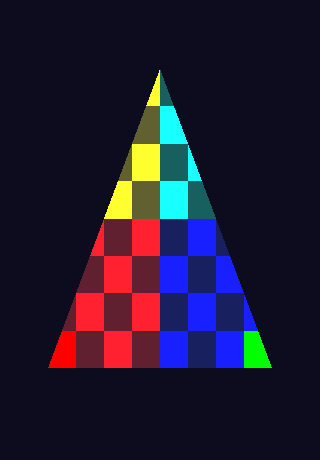
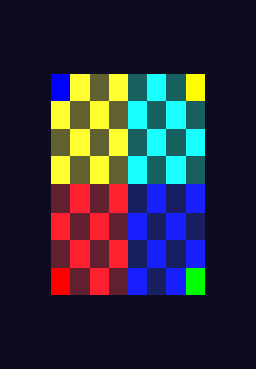
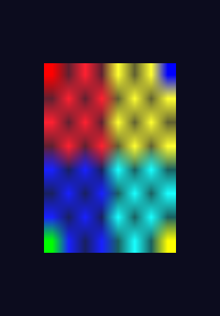

# IOSretroMob

**Historical iOS Game Preservation & Compatibility**

An experimental preservation platform for legacy iOS games, built on [S5LBox](https://github.com/j0shua-SYSON/S5LBox) by **j0shua-SYSON**. S5LBox supplies the ARMv6 CPU, S5L8900 device models, boot infrastructure and application shell. IOSretroMob adds a bounded graphics compatibility pipeline, original diagnostics and a firmware-free verification laboratory.

This is an early research project. Historical iPhone OS and our own diagnostic applications have executed locally. **A historical Unity game and an Android runtime have not been demonstrated.** No firmware, Apple SDK, game or decryption key is distributed.

## Origin and what IOSretroMob adds

The engine is based on S5LBox [`6f203ba`](https://github.com/j0shua-SYSON/S5LBox/commit/6f203ba550b49afadee008c7eb55373a838eed33), with the local source adaptations preserved. The separate comparison with public upstream [`35bd002`](https://github.com/j0shua-SYSON/S5LBox/commit/35bd00220d5bb0d1239bd04e0e4a7ac1eb1f784f) was made on 2026-10-09. This is a curated source fork, not an independent S5L8900 emulator.

| Area | Attribution and verified distinction |
|---|---|
| ARMv6, XNU boot, launchd, SpringBoard, touch, MBX 2D | Inherited S5LBox work. Current upstream has further app, USB and MBX composition developments. |
| Six recognized VGP program/state envelopes | Local `mbx_vgp_decode`; full normalized-envelope digest gates, not a general VGP interpreter. |
| Diagnostic triangle transformation, clipping, colour and UV interpolation | Local `mbx_vgp_raster`; integration into the guarded MBX/GART path. Current upstream also renders bounded transformed textured quads; this project does not claim to invent transformations or filtering. |
| Own RGBA8 upload with GL_NEAREST / GL_LINEAR | Local diagnostic subset, tested analytically and observed in historical guest CLCD captures. Distinct from upstream BGRA8 composition samplers. |
| Snapshot continuity | Local v33 adds a TA FIFO; v32 migration is tested. Upstream v33 has a different layout: **do not interchange snapshots**. |
| Capture / Z observer | Local CLCD sampling and read-only, opt-in depth-surface journaling; no implemented depth buffer. |
| Public lab | IOSretroMob CLI, five original synthetic scene replays, independent pixel checks, bounded TA-input inspector and an authenticated capture gallery. |

See [UPSTREAM.md](UPSTREAM.md) for source locations, limitations and the comparison matrix.

## Actual results

These are **authentic sampled guest CLCD scanouts**, copied byte-for-byte from local experiments on 2026-10-09. They are not public replay outputs or generated illustrations. Two triangle poses demonstrate changed geometry; they establish no sustained display rate.

| Own UIKit diagnostic | Coloured triangle, 190° | Triangle rotation, 330° |
|---|---|---|
|  |  |  |

| Textured triangle | Textured square | GL_LINEAR, 270° |
|---|---|---|
|  |  |  |

[Gallery provenance and hashes](demos/gallery/manifest.json) identifies every artifact and its historical source. The UIKit image includes the guest status bar; no Apple logo, commercial artwork or game asset is included. The three texture scanouts can be checked again against their own geometric inputs using `./iosretromob verify-gallery`.

## Current compatibility

| Milestone | Evidence and boundary |
|---|---|
| iPhone OS 3.1.3 (iPhone 3G, 7E18) | Historical local XNU → launchd → SpringBoard execution. Inherited boot path; authorized firmware required for reproduction. |
| UIKit and touch | Own guest diagnostic executed; blue no-touch and red touch controls retained privately. Published blue image is the no-touch control. |
| OpenGL ES 1.1 | Own RMGLES1/RMTexture subset: colour triangles, rotations, opaque RGBA8 nearest/linear textures. No GLES conformance claim. |
| Depth / transparency / dithering | Depth format and Z pipeline unresolved; host straight-alpha semantic tests exist, guest blend envelopes unsupported. Local GLES dithering remains rejected. |
| Historical Unity / Temple Trouble | Not executed or validated. No game resources distributed. |
| Android ARM64 | Nine inherited/local targets previously cross-compiled (API 26, NDK r28c). No APK/JNI runtime or physical S23 validation. |

Full evidence levels and unsupported states are in [COMPATIBILITY.md](COMPATIBILITY.md).

## Build and test on macOS

Install Xcode Command Line Tools, CMake and Python 3.9 or newer. From a clean checkout:

```sh
./iosretromob doctor
./iosretromob test
./iosretromob replay lab/fixtures/square-linear.json --output .local/linear-demo
./iosretromob inspect lab/fixtures/ta-input.json
./iosretromob verify-gallery
```

`test` configures a Release build, compiles locally with `-j2` and runs CTest. Public tests and replays need **no Apple files**. Replay images are explicitly synthetic and their full scanouts are compared against an independent analytic reference. The inspector checks one bounded input layout; it does not validate shader semantics or produce frames. See [BUILDING.md](BUILDING.md) and [TESTING.md](TESTING.md), including optional LLVM diagnostic-builder checks and the loopback socket requirement.

## Firmware

Provide your own authorized firmware and any required decryption information locally. Do not commit them. The private boot path is documented in [FIRMWARE.md](FIRMWARE.md) and the inherited [boot-chain documentation](docs/BOOT_CHAIN.md). Public tests are separate from firmware-dependent guest acceptance tests. Snapshots contain private guest state and are neither included nor interchangeable with current upstream snapshots.

## Roadmap

Resolve and independently validate Z state and framebuffer formats; expand only measured program/state families; execute an authorized historical Unity runtime with explicit evidence; then build and validate a minimal Android ARM64 host on a physical device. Each step has an acceptance gate in [ROADMAP.md](ROADMAP.md).

## Credits and licensing

MIT. The original [LICENSE](LICENSE), copyright © 2026 j0shua-SYSON, is preserved unchanged. Original IOSretroMob diagnostic and lab additions are also MIT. [THIRD_PARTY_NOTICES.md](THIRD_PARTY_NOTICES.md) and [UPSTREAM.md](UPSTREAM.md) document attribution. No SHMUP GPL code, Apple framework, game asset or historical SDK is included.

[French introduction](README.fr.md) · [Architecture](ARCHITECTURE.md) · [Diagnostic source guide](demos/README.md) · [Publication audit](reports/PUBLIC_REPOSITORY_AUDIT.md)
