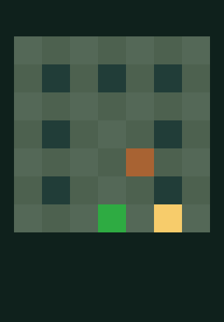

# Relic Maze — première partie complète dans iPhone OS 3.1.3

10 octobre 2026. **PASS : niveau terminé dans le véritable processus ARMv6 invité, par 25 touches Z2 et callbacks UIKit.** État final : joueur `(6,7)`, caisse `(5,5)`, trois reliques (`mask=7`), dalle active et `won=1`. Le dernier `rm_step` renvoie `2`. Le framebuffer final est réellement capturé ; aucun état de victoire n’a été injecté depuis le Mac.

La preuve combine le journal invité extrait du disque après arrêt, les états attendus d’un solveur indépendant et les pixels de la fenêtre CLCD. Les tests macOS constituent les régressions et la préparation ; ils ne remplacent pas cette exécution invitée. Le plateau est affiché et le niveau est terminé par commandes tactiles réelles. La composition visuelle complète du HUD et des boutons reste à capturer.

## Binaire réutilisé et campagne unique

Branche locale : `codex/relic-maze-armv6-first-launch`. HEAD conservé : `d25814b873aa528ed223651363e5993541cf6654`, quatre commits, aucun nouveau commit. Le [premier lancement](ARMV6_FIRST_LAUNCH.md) et ses huit fichiers de preuve restent inchangés.

Le bundle SDK-free `armv6-04/RelicMaze.app` et le payload final du premier lancement sont réutilisés **sans reconstruire le jeu exécuté** : Mach-O ARMv6 32 bits, APIs UIKit/EAGL/OpenGL ES 1.1, six fichiers de bundle, 27 304 octets. Après arrêt, les six fichiers installés dans `/Applications/RelicMaze.app` sont comparés octet par octet à ce bundle, avec vérification des modes ; les sept entrées du catalogue incluent le répertoire. Le binaire de 24 643 octets a pour SHA-256 :

`e23578d8dd3b7fc1d471efbf5d57dd55b982d82fe5d2f3b644023da7913242ca`

Payload : `3d97162d5b1f0c0eac08734244dc171bbbc909ac06df94865c165a68e8fcc6c6`.

Le premier appel du CLI a refusé les 27 taps avec `--touch: at most 8 taps`, **avant provisioning, disque ou instruction invitée**. Ce contrôle aurait dû être fait dès la préparation initiale. Son diagnostic a conduit à une correction générique et bornée du CLI, décrite ci-dessous. Le dossier `cold-01/` ne contient aucun disque ; stdout/stderr et résultat du refus sont conservés.

**Une seule exécution invitée**, dans `work/relic-maze-full-2026-10-10/cold-02/rootfs.img`, créé depuis le firmware canonique ; aucun ancien disque ni checkpoint n’est utilisé comme média mutable. Le CLI est lancé depuis ce dossier, avec ses sorties `firmware/screen.ppm` locales à la campagne. Les trois firmwares et les neuf composants de référence sont hashés avant et après ; les ancêtres sont vérifiés sans liens symboliques, et l’absence d’un autre bootkernel actif est contrôlée avant démarrage.

La campagne s’arrête normalement à **10 000 000 000 instructions**, code **0**, après **1066.74 s** côté hôte. Aucun arrêt de budget. Le processus invité est **PID 39** (`RM_PID=00000027`, valeurs du journal en hexadécimal). `UIApplicationMain`, le callback de lancement UIKit, le contexte EAGL courant et le FBO complet `0x8cd5` sont confirmés. Le journal annonce OpenGL ES-CM 1.1 et PowerVR MBXLite with VGPLite. Les 26 présentations renvoient 1 ; les 26 contrôles de texture, de dessin et de présentation renvoient zéro erreur. Depth, blend et dither sont désactivés, comme lors du premier lancement.

## Solution et événements tactiles

Solution indépendante, applicable à l’état exact `(joueur=1,1 ; caisse=3,5 ; mask=0 ; won=0)` :

```text
DDDDDDUURRRUURUUDDRRDDDDL
```

Le solveur Python vérifie l’identité des trois cartes source et les transitions sans appeler le moteur C depuis le Mac. Le [plan tactile](FULL_TOUCH_PLAN.json) est une attente préparée côté hôte ; les [preuves d’exécution](full-playthrough/EVIDENCE.json) contiennent les états réellement journalisés et la livraison Z2.

| Direction | Tag UIKit | Centre global de touche | Rectangle du bouton |
|---|---:|---|---|
| U | 1 | `(160,387)` | `(130,366,60,42)` |
| D | 2 | `(160,435)` | `(130,414,60,42)` |
| L | 3 | `(90,435)` | `(60,414,60,42)` |
| R | 4 | `(230,435)` | `(200,414,60,42)` |

Les 25 taps de jeu commencent à `7 400 000 000`, espacés de `100 000 000` instructions, maintien `1 000 000`, relâchement avant le suivant. Le dernier est à `9 800 000 000`. Il y a aussi deux taps système (dismiss et lancement), donc **27 taps CLI et 25 callbacks de jeu**, plus deux gestes système. Les 27 pressions et relâchements sont acceptés par Z2 aux instructions demandées, sans refus. L’acceptation par le périphérique seule ne prouve pas UIKit : les 25 tags des callbacks invités sont séparément comparés à la solution, ainsi que les 25 retours de `rm_step` (24 fois 1, puis 2).

Les **26 états invités**, état initial compris, sont tous identiques aux attentes indépendantes ; premier écart : aucun. Le tableau suivant donne les états réellement reçus après chaque touche. Les indices et positions sont décimaux ; dans le journal brut, `RELIC_MOVES=00000019` signifie 25, et `RELIC_FRAME=0000001a` signifie 26.

| Mouvement | Touche CLI `instruction:x:y:hold` | Joueur | Caisse | Mask | Dalle | won | rm_step |
|---:|---|---|---|---:|---:|---:|---:|
| 0 | État initial journalisé | `(1,1)` | `(3,5)` | 0 | 0 | 0 | — |
| 1 (D) | `7400000000:160:435:1000000` | `(1,2)` | `(3,5)` | 0 | 0 | 0 | 1 |
| 2 (D) | `7500000000:160:435:1000000` | `(1,3)` | `(3,5)` | 0 | 0 | 0 | 1 |
| 3 (D) | `7600000000:160:435:1000000` | `(1,4)` | `(3,5)` | 0 | 0 | 0 | 1 |
| 4 (D) | `7700000000:160:435:1000000` | `(1,5)` | `(3,5)` | 0 | 0 | 0 | 1 |
| 5 (D) | `7800000000:160:435:1000000` | `(1,6)` | `(3,5)` | 0 | 0 | 0 | 1 |
| 6 (D) | `7900000000:160:435:1000000` | `(1,7)` | `(3,5)` | 2 | 0 | 0 | 1 |
| 7 (U) | `8000000000:160:387:1000000` | `(1,6)` | `(3,5)` | 2 | 0 | 0 | 1 |
| 8 (U) | `8100000000:160:387:1000000` | `(1,5)` | `(3,5)` | 2 | 0 | 0 | 1 |
| 9 (R) | `8200000000:230:435:1000000` | `(2,5)` | `(3,5)` | 2 | 0 | 0 | 1 |
| 10 (R) | `8300000000:230:435:1000000` | `(3,5)` | `(4,5)` | 2 | 0 | 0 | 1 |
| 11 (R) | `8400000000:230:435:1000000` | `(4,5)` | `(5,5)` | 2 | 1 | 0 | 1 |
| 12 (U) | `8500000000:160:387:1000000` | `(4,4)` | `(5,5)` | 2 | 1 | 0 | 1 |
| 13 (U) | `8600000000:160:387:1000000` | `(4,3)` | `(5,5)` | 2 | 1 | 0 | 1 |
| 14 (R) | `8700000000:230:435:1000000` | `(5,3)` | `(5,5)` | 2 | 1 | 0 | 1 |
| 15 (U) | `8800000000:160:387:1000000` | `(5,2)` | `(5,5)` | 2 | 1 | 0 | 1 |
| 16 (U) | `8900000000:160:387:1000000` | `(5,1)` | `(5,5)` | 3 | 1 | 0 | 1 |
| 17 (D) | `9000000000:160:435:1000000` | `(5,2)` | `(5,5)` | 3 | 1 | 0 | 1 |
| 18 (D) | `9100000000:160:435:1000000` | `(5,3)` | `(5,5)` | 3 | 1 | 0 | 1 |
| 19 (R) | `9200000000:230:435:1000000` | `(6,3)` | `(5,5)` | 3 | 1 | 0 | 1 |
| 20 (R) | `9300000000:230:435:1000000` | `(7,3)` | `(5,5)` | 3 | 1 | 0 | 1 |
| 21 (D) | `9400000000:160:435:1000000` | `(7,4)` | `(5,5)` | 3 | 1 | 0 | 1 |
| 22 (D) | `9500000000:160:435:1000000` | `(7,5)` | `(5,5)` | 3 | 1 | 0 | 1 |
| 23 (D) | `9600000000:160:435:1000000` | `(7,6)` | `(5,5)` | 3 | 1 | 0 | 1 |
| 24 (D) | `9700000000:160:435:1000000` | `(7,7)` | `(5,5)` | 7 | 1 | 0 | 1 |
| 25 (L) | `9800000000:90:435:1000000` | `(6,7)` | `(5,5)` | 7 | 1 | 1 | 2 |

La porte `(4,7)` passe du brun au vert lorsque la caisse atteint la dalle `(5,5)` au mouvement 11. Le journal donne la dalle active ; le code inchangé définit l’ouverture par cette condition, et les pixels de porte sont vérifiés. Cette solution ne traverse pas cette porte : aucune traversée supplémentaire n’est revendiquée. Les reliques sont collectées aux mouvements 6, 16 et 24 ; le mouvement 25 rejoint la sortie `(6,7)`.

## Captures authentiques et vérification indépendante

73 images CLCD distinctes ont été enregistrées pendant le démarrage et la partie. Le sampler est limité à 128 images, avec intervalle de 50 000 000 instructions et déduplication consécutive. **25 captures correspondent exactement aux états après les mouvements 1 à 25.** Pour chacune, 441 points indépendants (neuf par case intérieure) sont comparés aux couleurs de la carte, du joueur, de la caisse, des reliques et de la porte : zéro différence de canal aux points contrôlés. Cela vérifie les éléments et positions échantillonnés, sans prétendre comparer toute la composition UIKit à une référence.

Les PPM sont les sorties originales du sampler ; les PNG sont une conversion sans perte, redécodée et comparée à tous les octets RGB du PPM. Aucun HUD, texte de victoire ou pixel synthétique n’est ajouté. [EVIDENCE.json](full-playthrough/EVIDENCE.json) donne l’état réel, l’instruction, le nom source et les SHA-256 PPM/RGB/PNG de chaque capture. Le journal original extrait est [GUEST_EXECUTION.log](full-playthrough/GUEST_EXECUTION.log).

| Jalon | Mouvement | Instructions de capture | Joueur | Caisse | Mask / dalle / won | Capture |
|---|---:|---:|---|---|---|---|
| Première relique | 6 | 7950000000 | `(1,7)` | `(3,5)` | `2 / 0 / 0` | [first_relic.png](full-playthrough/first_relic.png) |
| Première poussée | 10 | 8350000000 | `(3,5)` | `(4,5)` | `2 / 0 / 0` | [crate_first_push.png](full-playthrough/crate_first_push.png) |
| Dalle et porte ouvertes | 11 | 8450000000 | `(4,5)` | `(5,5)` | `2 / 1 / 0` | [plate_and_gate_open.png](full-playthrough/plate_and_gate_open.png) |
| Deuxième relique | 16 | 8950000000 | `(5,1)` | `(5,5)` | `3 / 1 / 0` | [second_relic.png](full-playthrough/second_relic.png) |
| Troisième relique | 24 | 9750000000 | `(7,7)` | `(5,5)` | `7 / 1 / 0` | [third_relic.png](full-playthrough/third_relic.png) |
| Victoire | 25 | 9850000000 | `(6,7)` | `(5,5)` | `7 / 1 / 1` | [victory.png](full-playthrough/victory.png) |

**Début de partie : état invité 0 présent dans le journal, mais aucune capture CLCD du plateau à zéro mouvement.** La première capture du plateau est après le mouvement 1. Ce jalon visuel est déclaré indisponible ; aucune image du solveur ou d’une autre campagne ne le remplace.

SHA-256 des six PPM authentiques :

| Capture | SHA-256 PPM |
|---|---|
| `first_relic.ppm` | `892e77f2b8e45206179cdb21f4d9d68dc9644532c7f221e1ee4c510306ef8b49` |
| `crate_first_push.ppm` | `23e9f4230d0c7ff123376e6345c3c293b0dc8cdd5211ca7e9a7b03300c94070b` |
| `plate_and_gate_open.ppm` | `f195e5274efc472849742f6da1126c6a3d19e9c9746fa29c92abc20195df8106` |
| `second_relic.ppm` | `785ec59ca5654d771fb7aa438b9e439eb5681aac90804506e8f46157e0d53e80` |
| `third_relic.ppm` | `06c28165b1dc3f6f9d2f18632bf7b6e25a8670b3e87b71de22c6943d661846d9` |
| `victory.ppm` | `900107841b8682d40f045ee6b14eb95bd8fa8481416a170eca8f37939b0b2102` |

Journal invité SHA-256 : `b386088962063ddd5e7bc7d58fe200c023c729f96e9ecc0ac43f97de69dab494`.



L’image montre le joueur sur la sortie, les trois reliques retirées, la caisse sur la dalle et la porte verte. **Le texte UIKit « WON » n’apparaît pas dans cette fenêtre brute.** La victoire est établie par `won=1` et `rm_step=2`, conjointement au plateau final capturé.

## Composition UIKit : étude après validation de la victoire

| Élément | Observation ou preuve | Limite |
|---|---|---|
| Fenêtre GLES / CLCD 0 | Plateau réel, 320 × 460 ; position `(0,20)`, stride 1280, format 7, order 0, framebuffer final `0x08982000` | L’image est relative à cette fenêtre, pas au panneau 320 × 480 |
| Fenêtre CLCD 2 | Active, 320 × 480, position `(0,0)`, stride 1280, format 7, framebuffer `0x08a1e000` | Son contenu pixel/alpha n’a pas été exporté par cette campagne |
| HUD et contrôles UIKit | Le binaire source crée UILabel, Up/Down/Left/Right et Reset dans UIWindow ; 25 actions UIKit sont reçues et le titre est actualisé après rendu | Leur apparence et le texte « WON » ne sont pas prouvés par l’image CLCD 0 |
| Fenêtres CLCD 1 et 3 | Désactivées au dernier état de registres | Aucun calque à reconstruire arbitrairement |

Les [registres finaux](full-playthrough/CLCD_REGISTERS.log) proviennent du CLI arrêté. `tools/guest_clcd_capture.h` sélectionne `s5l_clcd_active_window`, puis exporte cette seule fenêtre. Dans `core/src/soc/clcd.c`, cette sélection prend le premier bit de fenêtre activé, suivant la sélection du pilote ; ce choix ne démontre pas à lui seul l’ordre de composition des calques. `s5l_clcd_scanout` transforme le framebuffer ARGB natif en RGB, **abandonne l’alpha**, et ne replace pas les pixels à la position du panneau. Les mots overlay/CSC/gamma non nuls sont au nombre de 0/0/0 dans l’état observé.

**Amélioration technique prioritaire : une capture générique de toutes les fenêtres activées au même instant**, avec octets natifs BGRA, alpha, position, géométrie, stride, format et registres de contrôle. Préserver l’export brut actuel et ses hashes. Il faut ensuite établir l’ordre effectif des calques et les règles d’alpha/prémultiplication avant d’ajouter un compositeur optionnel 320 × 480. Une simple superposition de deux PPM RGB serait infidèle, car leur alpha est déjà perdu. Tester les limites mémoire, positions et formats sur petites fixtures synthétiques explicitement marquées, puis valider les vrais calques invités. Ne pas spécialiser la capture pour Relic Maze et ne pas dessiner les boutons côté Mac.

Aucun changement du renderer ou du CLCD n’a été entrepris pour cette étude, aucun second boot ni snapshot. L’accès aux pixels de la fenêtre 2 reste à instrumenter ; leur seule activation ne constitue pas une preuve de leur rendu visuel. Cette limite ne bloque plus la preuve de terminaison du niveau.

## Modifications et régressions

Deux fichiers suivis seulement sont modifiés pendant cette mission :

- `tools/bootkernel.c` : capacité bornée `TOUCH_TAP_MAX` de 8 à 32. Les tableaux et la validation partagent cette constante ; aucune modification des coordonnées, de l’injection Z2, des APIs invitées, du GPU ou du cœur du jeu.
- `core/tests/check_bootkernel_options.cmake` : tests print-config pour 32 taps acceptés, 33 refusés et huit taps historiques encore acceptés.

Seul l’objet du CLI est recompilé avec les options Release existantes, puis lié aux bibliothèques locales du cœur déjà validées. Le nouvel exécutable isolé `build-cli/bootkernel` est utilisé pour cette campagne : SHA-256 `047148f5d7f4a240858c02015348b6443f27b98c035c09950a4f9824b9ddba29`. L’ancien `build/core/bootkernel` reste intact : `384ce2d001f1c4e12ab70f860eb5d79cc4cb5999b5dfc47123a3c877084a9678`. Il conserve donc la limite de huit taps ; pour reproduire les 25 mouvements, employer le nouveau CLI ou une compilation normale des sources modifiées. Aucun rebuild global du moteur.

Le jeu, ses ressources, sa logique et `unity33/` sont inchangés pendant cette mission. Nouveaux fichiers : ce rapport, `FULL_TOUCH_PLAN.json`, six paires PNG/PPM, `EVIDENCE.json`, journal invité et registres CLCD. Les logs, scripts de préparation/reproduction/validation, patch CLI et builds temporaires restent privés dans `.local/relic-maze-full-2026-10-10/` ignoré. Aucun `git add`, commit, push, release, CI ou GitHub Actions.

| Validation exécutée | Résultat | Portée |
|---|---|---|
| CMake Release du jeu et compilation `-j2` | PASS | Host arm64, nouveau build isolé ; pas le binaire invité de la campagne |
| CTest logique et atlas Relic Maze | 2/2 PASS | Logique, collisions/progression et génération de texture |
| Solveur indépendant | PASS | Trois cartes identiques, solution de 25 mouvements |
| Outils de builder ARMv6 | 8/8 PASS | Tests Python avec LLVM disponible, construction réellement exercée |
| Contrôles bundle CFBundle | 2/2 PASS | Layout plat, métadonnées et erreurs de bundle |
| GPU et tactile du moteur existant | 5/5 PASS | `power_vr_mbx2d`, `power_vr_mbx_vgp`, `multitouch_z2`, `app_touch_map`, `app_touch_queue` |
| Préflight options CLI modifié | PASS | Suite CMake complète, notamment limites 8/32/33 taps |
| Préflight external-md CLI modifié | PASS | Suite CMake, destination neuve et contraintes média |
| Binaire installé, état invité, touches et pixels | PASS | 6 fichiers identiques, 27 taps Z2, 25 callbacks, 26 états, 25 images de plateau |
| `git diff --check` | PASS | Deux fichiers suivis modifiés |
| Audit public Git suivi et tous objets | PASS | 386 fichiers, 4 commits, 444 objets / 399 blobs, aucune anomalie |

**Aucun test sélectionné n’est sauté.** La ligne CMake « Check for working C compiler … skipped » appartient à la configuration et n’est pas un sous-test ignoré. La suite moteur complète n’est pas relancée : les cinq tests ciblés utilisent les binaires conservés et les deux suites CLI utilisent le nouvel exécutable isolé. Les replays publics non concernés ne sont pas relancés. Unity 3.3, audio et performances d’autres jeux ne sont pas validés par cette mission.

Le CLI tourne avec `--fast`, qui désactive les observateurs de modes/syscalls/lifecycle : ses histogrammes vides et la phrase « NO USER-MODE INSTRUCTION EVER RETIRED » ne sont pas un compteur fiable d’absence d’exécution dans ce mode. La preuve utilisée ici est le journal fsync du processus invité, le bundle installé et le framebuffer. Le journal UART conserve les avertissements SDIO/caméra et l’événement Graphics Recovery du démarrage ; aucune erreur GL ni divergence de progression n’est observée dans la partie.

## Stockage et conservation

Mesures `df -h`, `df -k`, `du -sh`, `du -sk`, tailles logiques et blocs alloués conservées avant/après dans les preuves privées. Budget : **600 000 000 octets** de nouvelles données, réserve minimale 5 Gio, `work/` inférieur à 10 000 000 000 octets.

| Périmètre | Octets logiques | Somme de blocs alloués (octets) |
|---|---:|---:|
| Anciennes données de quatre cold boots préservées | 1870055158 | 1742049280 |
| Nouvelle campagne work, disque et sorties | 467715541 | 435748864 |
| Preuves/builds privés de cette mission | 41692596 | 42934272 |
| Nouvelles captures et métadonnées du rapport | 2693574 | 2719744 |
| Total work IOSretroMob | 2337770699 | 2177798144 |
| Work historique S5LBox inchangé | 4401139574 | 4356079616 |

Environ **512,2 Mo logiques** de nouvelles données au total, rapports inclus, donc sous 600 Mo. Pic observé pendant le processus : **509308715 octets**, avant les exports légers finaux. Le disque seul mesure **466 825 216 octets** ; ses deux captures finales PPM et son journal UART expliquent les sorties work supplémentaires. Zéro snapshot, un seul nouveau disque mutable et aucune suppression. Les scripts finaux et le rapport ajoutent quelques kilo-octets aux mesures du tableau ; la mesure finale exacte est `storage-after.json`.

`df -h` après campagne : **70 Gio disponibles**. Mesure `statvfs` après campagne : **74746675200 octets**, contre **75243819008** avant. `du -sh` : work produit **2.0G**, work historique **4.1G**, nouvelles preuves privées **41M**, nouveau work **416M**. Les tailles allouées APFS ne représentent pas une occupation physique exclusive ; le changement de `df` inclut toute l’activité du Mac et n’est pas attribué entièrement à cette campagne. Aucune économie par clone n’est revendiquée.

Le contrôle SHA-256/modes couvre 15 263 fichiers/liens historiques, les neuf composants de référence, les 415 éléments des anciennes preuves privées, les 15 fichiers des quatre anciens cold boots, les 71 éléments du jeu et les huit fichiers de premier lancement. **Aucun changement, ajout ou retrait dans les périmètres historiques, du jeu et des anciennes preuves.** Les seuls ajouts dans le dossier des rapports sont les preuves de cette mission. Les neuf composants restent intacts et aucune donnée préexistante n’est supprimée. Les empreintes exactes et résultats se trouvent dans `baseline.json`, `preflight-02.json` et `integrity-after.json` privés.

Firmware Apple, médias VM, snapshots et SDK restent hors Git. L’audit suivi/historique est sans anomalie : 13 635 461 octets de fichiers suivis (sources locales modifiées incluses), 16 222 771 octets logiques d’objets Git. Les nouveaux exemples et rapports sont encore non suivis ; l’audit ne les transforme pas en contenu publié. Les attributions S5LBox et licences MIT restent inchangées. Aucun développement Unity ni publication distante.

## Reproduction et preuves locales

Les commandes absolues réellement exécutées, environnement, PID hôte, durée et code retour sont dans `result-02.json` ; le refus initial dans `result.json`. Les scripts préservés sous `.local/relic-maze-full-2026-10-10/reproduction/` couvrent préparation indépendante, tests, compilation CLI seule, run borné, validation HFS/journal/pixels, export sans perte et contrôle d’intégrité/stockage. Ne pas les rejouer contre une destination existante et ne pas produire un nouveau disque sans refaire le budget. Les scripts de run refusent un autre bootkernel actif et s’arrêtent avant épuisement de la réserve.

Commande de reproduction (variables locales à renseigner ; firmware autorisé en lecture seule, destination fraîche) :

```sh
# R = dépôt IOSretroMob ; S = dépôt historique S5LBox
# O = R/.local/relic-maze-2026-10-10
# L = R/.local/relic-maze-full-2026-10-10
# D = nouveau dossier temporaire contenant firmware/ ; CAP = dossier de captures vide
S5LBOX_CLCD_CAPTURE_DIR="$CAP" S5LBOX_CLCD_CAPTURE_INTERVAL=50000000 \
"$L/build-cli/bootkernel" "$S/firmware/kernel.macho" \
  -d "$S/firmware/devicetree.bin" -c 'debug=0x8 serial=1 nand-enable-adm=0' \
  --external-md "$S/firmware/rootfs.img" "$D/rootfs.img" \
  -R 128 -n 10000000000 -Z 100000000 \
  --framebuffer --iomfb-display --multitouch --activate \
  --mbx --no-ca-software-render --fast --jb-codesign --jb-payload \
  --jailbreak-payload "$O/combined-final-payload.tar" \
  --drag 4000000000:57:431:305:431:24:165000000 \
  --touch 6010000000:160:334:24000000 \
  --drag 6500100000:275:220:40:220:24:165000000 \
  --touch 6900100000:116:60:1000000 \
  --touch 7400000000:160:435:1000000 \
  --touch 7500000000:160:435:1000000 \
  --touch 7600000000:160:435:1000000 \
  --touch 7700000000:160:435:1000000 \
  --touch 7800000000:160:435:1000000 \
  --touch 7900000000:160:435:1000000 \
  --touch 8000000000:160:387:1000000 \
  --touch 8100000000:160:387:1000000 \
  --touch 8200000000:230:435:1000000 \
  --touch 8300000000:230:435:1000000 \
  --touch 8400000000:230:435:1000000 \
  --touch 8500000000:160:387:1000000 \
  --touch 8600000000:160:387:1000000 \
  --touch 8700000000:230:435:1000000 \
  --touch 8800000000:160:387:1000000 \
  --touch 8900000000:160:387:1000000 \
  --touch 9000000000:160:435:1000000 \
  --touch 9100000000:160:435:1000000 \
  --touch 9200000000:230:435:1000000 \
  --touch 9300000000:230:435:1000000 \
  --touch 9400000000:160:435:1000000 \
  --touch 9500000000:160:435:1000000 \
  --touch 9600000000:160:435:1000000 \
  --touch 9700000000:160:435:1000000 \
  --touch 9800000000:90:435:1000000
```

Lancer depuis `$D` afin de confiner les sorties du CLI. La copie n’est pas un delta de checkpoint : elle est provisionnée depuis le firmware canonique et le payload du jeu. Ne pas employer de médias historiques comme destination.

Régressions exécutées :

```sh
cmake -S examples/RelicMaze -B "$L/build-host" -DCMAKE_BUILD_TYPE=Release
cmake --build "$L/build-host" -j2
ctest --test-dir "$L/build-host" --output-on-failure
python3 examples/RelicMaze/tests/verify_level.py
# IOSRETROMOB_LLVM_BIN indique les outils LLVM déjà présents, sans SDK iPhone propriétaire.
python3 -m unittest discover -s tests/guest-apps -p 'test_*.py' -v
python3 examples/RelicMaze/tests/test_bundle_layout.py -v
ctest --test-dir build -R '^(power_vr_mbx2d|power_vr_mbx_vgp|multitouch_z2|app_touch_map|app_touch_queue)$' -V
cmake -DBOOTKERNEL="$L/build-cli/bootkernel" -P core/tests/check_bootkernel_options.cmake
cmake -DBOOTKERNEL="$L/build-cli/bootkernel" -P core/tests/check_bootkernel_external_md.cmake
python3 tools/audit_public.py
```

**Blocage restant : capture générique de la composition UIKit 320 × 480, et absence de capture de l’état initial avant mouvement. Aucun blocage de progression du niveau observé.** Le prochain travail utile porte sur les calques CLCD et leur alpha, après budgétisation et conservation de ces preuves ; aucune nouvelle campagne n’est lancée ici.
